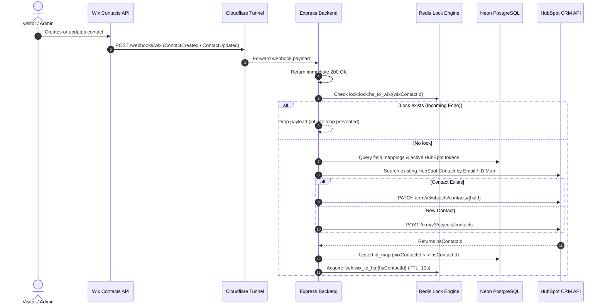
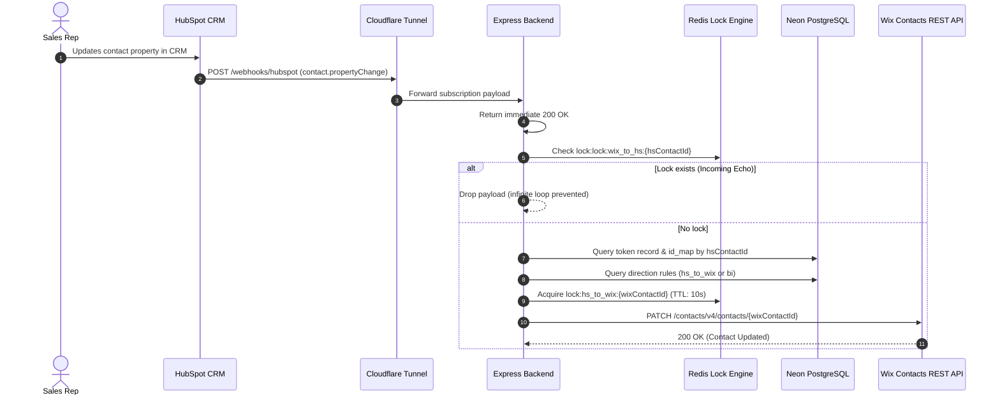

# Wix ↔ HubSpot Bi-Directional CRM Sync Engine

[](https://www.typescriptlang.org/)
[](https://nodejs.org/)
[](https://expressjs.com/)
[](https://neon.tech/)
[](https://redis.io/)
[](https://astro.build/)
[](https://design.wix.com/)
[](LICENSE)

A production-grade, enterprise-ready bi-directional synchronization system connecting **Wix eCommerce / CMS** contacts and form submissions with **HubSpot CRM**. Built with multi-tenant architecture, military-grade **AES-256-GCM** token encryption, distributed **Redis** transactional locking for zero-echo loop prevention, and an interactive **Wix Design System** dashboard extension.

---

## Table of Contents
- [Architecture Overview](#architecture-overview)
- [System Data Flow](#system-data-flow)
- [Key Features](#key-features)
- [Monorepo Workspace Structure](#monorepo-workspace-structure)
- [Database Schema & Entity Mapping](#database-schema--entity-mapping)
- [API Reference](#api-reference)
- [Prerequisites & Requirements](#prerequisites--requirements)
- [Environment Variables](#environment-variables)
- [Installation & Quick Start](#installation--quick-start)
- [HubSpot App CLI Deployment](#hubspot-app-cli-deployment)
- [Testing & Quality Verification](#testing--quality-verification)
- [Security & Compliance](#security--compliance)
- [License](#license)

---

## Architecture Overview

```
                                      +---------------------------------------------+
                                      |                HubSpot CRM                  |
                                      +---------------------------------------------+
                                                 ▲                      |
                                (REST API Patch) |                      | (Webhooks)
                                                 |                      ▼
+-----------------------+             +---------------------------------------------+
|    Wix Site / CRM     |             |         Cloudflare Tunnel Proxy             |
+-----------------------+             | (hearing-spotlight-submissions-cartoons...) |
       |          ▲                   +---------------------------------------------+
       |          |                                         |
(Hooks)|          |(REST Patch)                             ▼
       ▼          |                   +---------------------------------------------+
+-----------------------+             |         Express Sync Engine (Backend)       |
| Cloudflare Tunnel In  |------------>| - Idempotency Lock Check (Redis)            |
+-----------------------+             | - Bi-Directional Property Mapper            |
                                      | - AES-256-GCM Decryptor                     |
                                      +---------------------------------------------+
                                              |                      |
                                              ▼                      ▼
                                     +-----------------+    +-----------------+
                                     |  Redis (Locks)  |    |  Neon Postgres  |
                                     |  (10s TTL Keys) |    | (Tokens & Maps) |
                                     +-----------------+    +-----------------+
```

The system operates across three decoupled layers:
1. **Express Integration Backend (`backend/`):** Robust Node.js service exposing webhook listeners (`/webhooks/wix`, `/webhooks/hubspot`), OAuth 2.0 handshake endpoints, and dynamic field mapping APIs.
2. **Wix Dashboard Extension (`frontend/`):** Full-page embedded Wix Business Manager extension built with Astro 5 and React 18, styled using `@wix/design-system` with live OAuth status indicators and interactive field rule mapping.
3. **HubSpot CLI Project (`hubspot-app/`):** Source-managed HubSpot developer project with declarative JSON configurations for app metadata and webhook subscriptions (`contact.creation`, `contact.propertyChange`).

---

## System Data Flow

### 1. Wix Contact → HubSpot CRM


### 2. HubSpot CRM → Wix Contacts


---

## Key Features

- **True Bi-Directional Synchronization:** Changes made in Wix (via UI, API, or form submissions) instantly propagate to HubSpot. Changes made in HubSpot CRM instantly update Wix contacts.
- **Infinite Loop & Echo Prevention:** Webhook ping-pong is completely eliminated using a distributed 10-second transactional lock pattern with fallback to local LRU memory if Redis is unavailable.
- **AES-256-GCM Token Encryption:** All HubSpot OAuth access and refresh tokens are encrypted at rest using an external 32-byte master key. Each encrypted payload stores an initialization vector (IV), authentication tag, and ciphertext (`iv.authTag.ciphertext`).
- **Marketing Lead & Hidden UTM Attribution:** Wix form submissions parse UTM campaign parameters (`utm_source`, `utm_medium`, `utm_campaign`, `utm_content`) and automatically map them to HubSpot marketing properties for complete funnel analytics.
- **Dynamic Field Mapping Table:** Administrators can map any custom Wix contact field to any HubSpot property with granular direction control (`Wix → HubSpot`, `HubSpot → Wix`, or `Bi-Directional ↔`).
- **Resilient Multi-Tenant ID Resolution:** Validates all incoming Wix site and tenant UUIDs with strict 36-character validation (`889ffdc1-a3a8-4b61-a988-93af8c4fdec2`), preventing tenant slicing errors.

---

## Monorepo Workspace Structure

```text
wix-hub/
├── backend/                             # Express.js Integration Backend
│   ├── src/
│   │   ├── config/                      # Environment variables, Neon DB, and Redis clients
│   │   │   ├── db.ts                    # Drizzle ORM PostgreSQL connection
│   │   │   ├── env.ts                   # Zod environment schema validation
│   │   │   └── redis.ts                 # ioredis client configuration
│   │   ├── controllers/                 # Route controllers
│   │   │   ├── mappingController.ts     # Field mapping retrieval and transaction saving
│   │   │   ├── oauthController.ts       # HubSpot OAuth handshake and popup callback
│   │   │   └── webhookController.ts     # Wix & HubSpot webhook listeners
│   │   ├── db/                          # Drizzle schema & migrations
│   │   │   ├── schema.ts                # tokens, mappings, and id_map tables
│   │   │   └── migrations/              # Generated SQL migrations
│   │   ├── middlewares/                 # Central error handling middleware
│   │   ├── routes/                      # Express route registrations
│   │   ├── services/                    # Business logic
│   │   │   ├── oauthService.ts          # HubSpot token exchange & AES encryption
│   │   │   └── syncService.ts           # Contact sync, mapping resolution, and locks
│   │   ├── utils/                       # AES-256-GCM crypto, validators, Redis locks
│   │   ├── app.ts                       # Express application bootstrap & CORS
│   │   └── server.ts                    # HTTP server entrypoint
│   ├── tests/                           # Verification test suites
│   ├── .env.example                     # Backend environment template
│   ├── drizzle.config.ts                # Drizzle kit configuration
│   ├── package.json                     # Backend scripts and dependencies
│   └── tsconfig.json                    # Backend TypeScript compiler configuration
│
├── frontend/                            # Wix Dashboard Page Extension
│   ├── src/
│   │   ├── extensions/dashboard/pages/
│   │   │   └── my-page/
│   │   │       ├── my-page.extension.ts # Wix dashboard extension definition
│   │   │       └── my-page.tsx          # React dashboard UI with Wix Design System
│   │   ├── pages/                       # Astro pages
│   │   │   └── index.astro              # Auto-redirect to dashboard extension
│   │   ├── env.d.ts                     # Environment type definitions
│   │   └── extensions.ts                # Wix app plugin registry
│   ├── astro.config.mjs                 # Astro configuration with Wix Hosting Adapter
│   ├── package.json                     # Frontend scripts and dependencies
│   ├── tsconfig.json                    # Frontend TypeScript configuration
│   └── wix.config.json                  # Wix App project metadata
│
├── hubspot-app/                         # HubSpot Developer CLI Project
│   ├── src/
│   │   └── app/
│   │       ├── app-hsmeta.json          # HubSpot App manifest & scopes
│   │       ├── webhooks.json            # Webhook subscription rules
│   │       └── webhooks/
│   │           └── webhooks-hsmeta.json # HubSpot webhook component schema
│   ├── hsproject.json                   # HubSpot Project configuration
│   └── HUBSPOT_PROJECTS.md              # HubSpot deployment reference
│
├── .gitignore                           # Workspace git ignore rules
├── package.json                         # Monorepo task orchestration scripts
└── README.md                            # Complete architecture & deployment guide
```

---

## Database Schema & Entity Mapping

Managed via [Drizzle ORM](https://orm.drizzle.team/) on [Neon Cloud PostgreSQL](https://neon.tech):

### 1. `tokens` Table
Stores multi-tenant OAuth credentials securely encrypted with AES-256-GCM:
| Column | Type | Description |
|---|---|---|
| `wix_instance_id` | `VARCHAR(255)` (PK) | 36-character Wix site/instance identifier |
| `hubspot_portal_id` | `VARCHAR(100)` | Authenticated HubSpot Portal ID |
| `access_token` | `TEXT` | AES-256-GCM encrypted access token (`iv.tag.cipher`) |
| `refresh_token` | `TEXT` | AES-256-GCM encrypted refresh token (`iv.tag.cipher`) |
| `expires_at` | `TIMESTAMP` | Token expiration timestamp |
| `created_at` | `TIMESTAMP` | Record creation timestamp |
| `updated_at` | `TIMESTAMP` | Token refresh timestamp |

### 2. `mappings` Table
Dynamic field routing preferences configured by the user in the Wix dashboard:
| Column | Type | Description |
|---|---|---|
| `id` | `SERIAL` (PK) | Auto-incrementing rule ID |
| `wix_instance_id` | `VARCHAR(255)` | Wix tenant ID |
| `wix_field` | `VARCHAR(255)` | Wix contact property path (e.g. `info.name.first`) |
| `hs_field` | `VARCHAR(255)` | HubSpot CRM property (e.g. `firstname`) |
| `direction` | `VARCHAR(20)` | Routing mode: `bi`, `wix_to_hs`, or `hs_to_wix` |
| `created_at` | `TIMESTAMP` | Rule creation timestamp |
| `updated_at` | `TIMESTAMP` | Last updated timestamp |

### 3. `id_map` Table
Cross-platform entity reference map for fast lookups:
| Column | Type | Description |
|---|---|---|
| `id` | `SERIAL` (PK) | Map ID |
| `wix_instance_id` | `VARCHAR(255)` | Wix tenant ID |
| `wix_contact_id` | `VARCHAR(255)` | Wix contact UUID |
| `hs_contact_id` | `VARCHAR(255)` | HubSpot Contact Object ID |
| `created_at` | `TIMESTAMP` | Mapping creation timestamp |
| `updated_at` | `TIMESTAMP` | Last modified timestamp |

---

## API Reference

### Health & Monitoring
| Method | Endpoint | Description |
|---|---|---|
| `GET` | `/health` | System health check and uptime status |

### HubSpot OAuth 2.0 Flow
| Method | Endpoint | Query / Body | Description |
|---|---|---|---|
| `GET` | `/auth/hubspot` | `?wixInstanceId={uuid}` | Generates state and redirects to HubSpot OAuth authorize page |
| `GET` | `/auth/hubspot/callback` | `?code={code}&state={state}` | Exchanges auth code for tokens, encrypts, and stores in Neon DB |

### Field Mapping Rules API
| Method | Endpoint | Headers / Body | Description |
|---|---|---|---|
| `GET` | `/api/mappings/:wixInstanceId` | - | Returns all saved field mapping rules for an instance |
| `POST` | `/api/mappings` | `{"wixInstanceId": "...", "mappings": [...]}` | Overwrites mapping rules atomically via transaction |
| `GET` | `/api/mappings/status/:wixInstanceId` | - | Checks if the instance has active HubSpot OAuth credentials |

### Webhook Ingestion Endpoints
| Method | Endpoint | Source | Description |
|---|---|---|---|
| `POST` | `/webhooks/wix` | Wix Automations / Events | Ingests `ContactCreated`, `ContactUpdated`, `FormSubmitted` |
| `POST` | `/webhooks/hubspot` | HubSpot App Webhooks | Ingests `contact.creation`, `contact.propertyChange` |

---

## Prerequisites & Requirements

- **Node.js:** v18.0.0 or higher (v20+ recommended)
- **Package Managers:** `pnpm` (v9+) or `npm` (v10+)
- **PostgreSQL:** Cloud Neon database or PostgreSQL 14+
- **Redis:** Local Redis (`localhost:6379`) or Upstash Redis URL
- **Cloudflare Tunnel:** `cloudflared` CLI installed
- **HubSpot CLI:** `@hubspot/cli` installed (`npm i -g @hubspot/cli`)
- **Wix CLI:** `@wix/cli` installed

---

## Environment Variables

### Backend Configuration (`backend/.env`)
```bash
PORT=3000
NODE_ENV=development
CORS_ORIGIN=*

# Neon Cloud PostgreSQL
DATABASE_URL=postgresql://neondb_owner:[PASSWORD]@[HOST]/neondb?sslmode=require

# Redis Connection (Idempotency Locks)
REDIS_URL=redis://localhost:6379

# Security: 32-byte Hex String for AES-256-GCM encryption
# Generate with: node -e "console.log(require('crypto').randomBytes(32).toString('hex'))"
ENCRYPTION_KEY=0123456789abcdef0123456789abcdef0123456789abcdef0123456789abcdef

# HubSpot OAuth App Credentials
HUBSPOT_CLIENT_ID=your-hubspot-client-id
HUBSPOT_CLIENT_SECRET=your-hubspot-client-secret
HUBSPOT_REDIRECT_URI=https://your-public-tunnel.trycloudflare.com/auth/hubspot/callback

# Wix App Configuration
WIX_APP_ID=8e6c01b1-395c-4fc9-a76a-1a9dce768765
WIX_APP_SECRET=bb9112c1-d541-46b7-aced-ec5fd4cfd5a0
```

### Frontend Configuration (`frontend/.env.local`)
```bash
WIX_CLOUD_PROVIDER="CLOUD_FLARE"
WIX_CLIENT_ID="8e6c01b1-395c-4fc9-a76a-1a9dce768765"
WIX_CLIENT_INSTANCE_ID="00000000-0000-0000-0000-000000000000"
WIX_CLIENT_PUBLIC_KEY="-----BEGIN PUBLIC KEY-----\n...\n-----END PUBLIC KEY-----"
WIX_CLIENT_SECRET="bb9112c1-d541-46b7-aced-ec5fd4cfd5a0"
```

---

## Installation & Quick Start

### 1. Clone & Install Dependencies
```bash
# Clone the repository
git clone https://github.com/tamiopia/hubspot-sync.git
cd hubspot-sync

# Install backend dependencies
cd backend && pnpm install && cd ..

# Install frontend dependencies
cd frontend && npm install && cd ..
```

### 2. Run Database Migrations
```bash
cd backend
pnpm drizzle-kit push
cd ..
```

### 3. Start Public Cloudflare Tunnel
In a dedicated terminal:
```bash
cloudflared tunnel --url http://localhost:3000 --protocol http2
```
*Copy your generated URL (e.g., `https://example.trycloudflare.com`) into your `backend/.env` file as `HUBSPOT_REDIRECT_URI` and update the HubSpot webhook target URL.*

### 4. Run Services Concurrently
From the root directory:
```bash
# Terminal 1: Launch Backend API
npm run dev:backend

# Terminal 2: Launch Wix Dashboard Extension Preview
npm run dev:frontend
```

---

## HubSpot App CLI Deployment

To sync your webhook subscriptions and app metadata to your HubSpot Developer Portal:

```bash
cd hubspot-app

# Authenticate with HubSpot Developer Account
hs auth

# Upload project configurations
hs project upload
```

---

## Testing & Quality Verification

Run complete TypeScript verification across the monorepo:

```bash
# 1. Typecheck Backend
pnpm --prefix backend exec tsc --noEmit

# 2. Build Backend Distribution
pnpm --prefix backend run build

# 3. Build Frontend Wix Bundle
npm --prefix frontend run build

# 4. Verify Monorepo Builds from Root
npm run build
```

---

## Security & Compliance

- **Zero Plaintext Credentials:** Tokens stored in the database are AES-256-GCM encrypted using authenticated encryption with dynamic 128-bit IVs.
- **Strict Parameter Sanitization:** All incoming requests are validated against Zod schemas. Tenant UUIDs strictly enforce 36-character RFC 4122 formatting.
- **Race Condition Immunity:** Redis transactions (`SET resource value EX 10 NX`) prevent duplicate processing across high-concurrency event streams.

---

## License

This project is licensed under the MIT License - see the [LICENSE](LICENSE) file for details.
